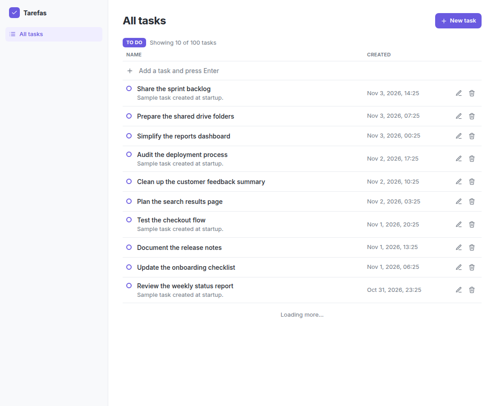
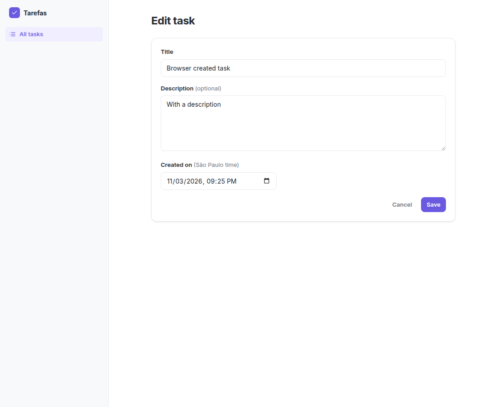
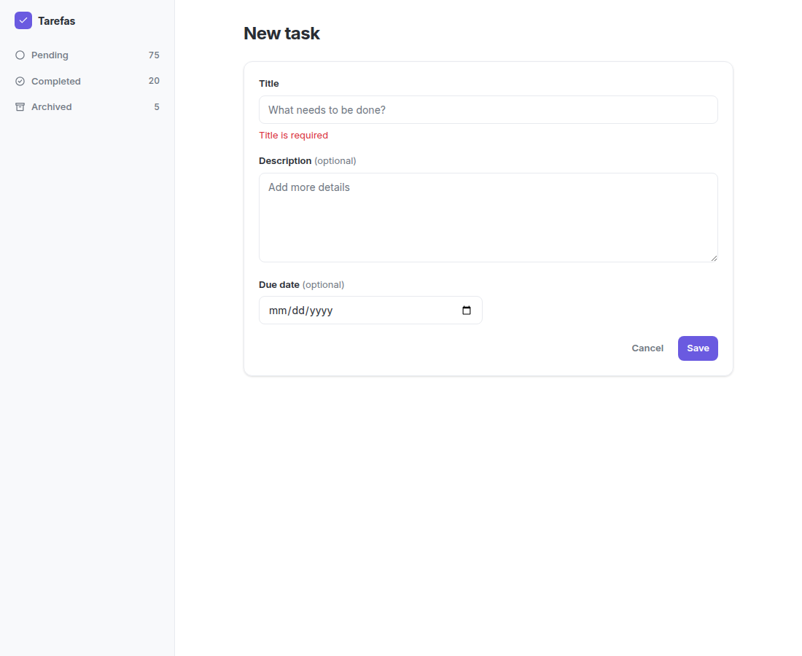
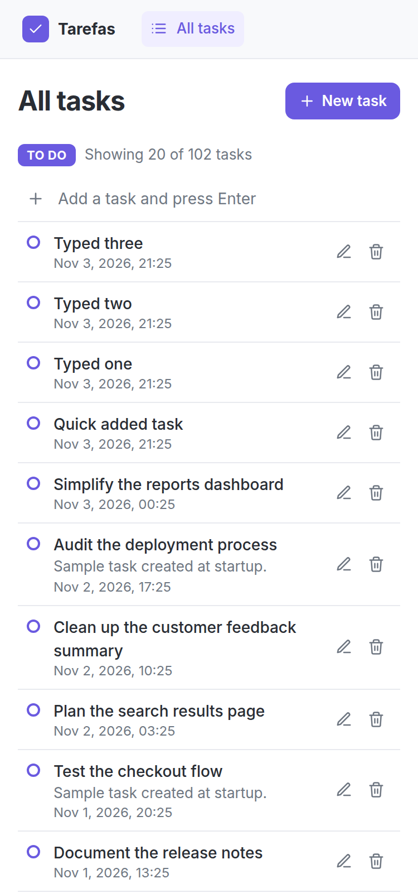
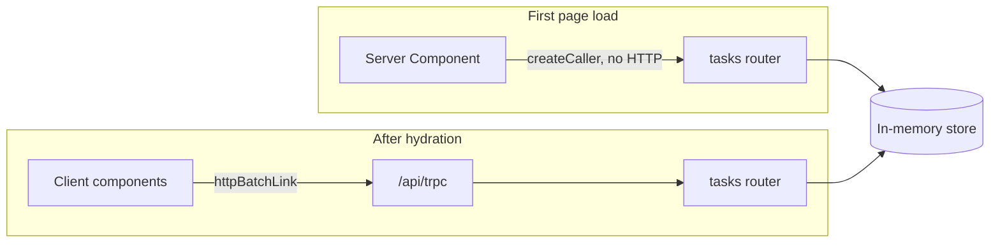

# Tarefas

**A fast, focused task manager: server-rendered on first paint, type-safe from server to UI, and built with as little code as the job allows.**

Add a task by typing one line, scroll through the list without ever hitting a "next page" button, and get a clear message when something goes wrong. There is no database to install and no environment variable to set: clone it and it runs.



## Highlights

- **Add tasks without leaving the list.** Type a title, press Enter, and keep typing the next one: focus stays in the field, even while the previous task is saving. The full form is one click away when you want a description.
- **Content on first paint.** The list arrives as HTML from the server, so there is no loading spinner on page load and no empty flash.
- **Infinite scroll you can see working.** It starts with 100 fictional tasks and loads 10 at a time, with a live "Showing 20 of 100 tasks" counter.
- **Pagination that survives deletions.** Pages are anchored to task ids, so removing a task never skips or repeats rows, even when the removed task is the one the next page starts from.
- **Editable date and time.** Every task shows when it was created, down to the minute, and the edit form can change it.
- **One source of truth for validation.** The form and the API use the same Zod schema, so they can't disagree. A title made only of spaces is rejected on both sides.
- **Errors people can read.** Validation failures reach the UI as "Title is required", not as a JSON dump. Editing a task someone deleted in another tab says so, and the list corrects itself. If the connection drops, the app says that too, and quick add gives your text back.
- **A real 404.** An unknown task id returns HTTP 404 with a friendly page, not a 200 with an error message inside.
- **Zero known vulnerabilities in production dependencies** at the time of writing, according to `npm audit --omit=dev`.
- **Works on a phone.** The layout adapts down to 375px, and row actions stay visible where there is no hover.

## Screenshots

| Editing, with date and time | Validation in the form | Mobile |
| --- | --- | --- |
|  |  |  |

## Quick start

Requires Node.js 20 or newer. Clone this repository, then run this from its folder:

```bash
npm install
npm run dev
```

Open http://localhost:3000. The app starts with 100 fictional tasks, so the list and infinite scroll work right away.

For a production build:

```bash
npm run build
npm start
```

`next start` reads the `PORT` environment variable if it is set.

## Tech stack

| Technology | Why it's here |
| --- | --- |
| **Next.js 15 (App Router)** | Server Components for first paint, plus the API route, in one app |
| **TypeScript** | Catches contract mismatches at build time |
| **tRPC v11** | The client calls typed procedures, with no REST layer or generated code to maintain |
| **Zod** | Validates input once, for both the form and the API |
| **TanStack Query** | Handles cache, mutations and infinite pagination |
| **Tailwind CSS v4** | Styling with design tokens and no component library |

## How it works

The first request is answered by the server, which calls the router in-process. From then on, the browser talks to the API, and TanStack Query keeps the list up to date.



### Project structure

```
src/
├── app/
│   ├── (list)/page.tsx           # task list, server-rendered per request
│   ├── (list)/loading.tsx        # skeleton shown while navigating to the list
│   ├── api/trpc/[trpc]/route.ts  # exposes the router over HTTP
│   ├── tasks/new/page.tsx        # create page
│   ├── tasks/[id]/edit/page.tsx  # edit page, loads the task on the server
│   ├── layout.tsx                # app shell: sidebar, font, tRPC provider
│   └── not-found.tsx             # 404 page
├── components/
│   ├── feedback.tsx              # success and error toast
│   ├── icons.tsx                 # inline SVG icons
│   ├── quick-add.tsx             # one-line task creation in the list
│   ├── task-form.tsx             # shared create and edit form
│   └── task-list.tsx             # list, delete, infinite scroll
├── lib/
│   ├── date.ts                   # date display and date input conversion
│   ├── error-message.ts          # readable message for connection failures
│   ├── task-schema.ts            # Zod schemas shared by form and API
│   └── trpc/                     # React client, provider, server caller
└── server/
    ├── routers/                  # tasks router and root router
    ├── store.ts                  # in-memory tasks and seed data
    └── trpc.ts                   # tRPC setup and error formatting
```

## Data model

| Field | Type | Notes |
| --- | --- | --- |
| `id` | `string` | Generated by the server, always increasing |
| `titulo` | `string` | Required, trimmed |
| `descricao` | `string` | Optional |
| `dataCriacao` | `string` | ISO-8601 timestamp, set by the server on creation and editable afterwards |

## API

Every procedure lives under `tasks`, at `/api/trpc/tasks.<procedure>`.

| Procedure | Type | Input | Errors |
| --- | --- | --- | --- |
| `list` | query | `cursor?`, `limit?` (default 10, max 50) | `BAD_REQUEST` |
| `getById` | query | `id` | `NOT_FOUND` |
| `create` | mutation | `titulo`, `descricao?` | `BAD_REQUEST` |
| `update` | mutation | `id`, `titulo`, `descricao?`, `dataCriacao?` | `BAD_REQUEST`, `NOT_FOUND` |
| `delete` | mutation | `id` | `NOT_FOUND` |

`list` returns `{ items, nextCursor, total }`. In `update`, leaving out `descricao` clears it, and leaving out `dataCriacao` keeps the current date.

Try it from a terminal while the app is running:

```bash
# Create a task
curl -X POST http://localhost:3000/api/trpc/tasks.create \
  -H 'content-type: application/json' \
  -d '{"titulo":"Write the docs"}'

# Try without a title: returns 400 with "Title is required"
curl -X POST http://localhost:3000/api/trpc/tasks.create \
  -H 'content-type: application/json' \
  -d '{"titulo":"   "}'

# List the 3 newest tasks
curl -G http://localhost:3000/api/trpc/tasks.list \
  --data-urlencode 'input={"limit":3}'
```

## Design decisions

| Decision | Why | Trade-off |
| --- | --- | --- |
| In-memory `Map` on `globalThis` | Survives hot reload, and pages and the API route see the same data | Data is lost on restart |
| `createCaller` for SSR | No HTTP request from the server to itself | Server Components bypass HTTP-level middleware |
| `force-dynamic` on the list page | The list changes constantly and must not be cached at build time | Every request renders on the server |
| ISO date strings | Travel through JSON unchanged, with no superjson or `Date` transformer | Dates must be parsed before display |
| Schema in its own file | The form imports it without pulling server code into the browser | One more file |
| Cursor based on increasing ids | Stable pages, even if the cursor's own task was deleted | The list follows creation order, so editing a task's date doesn't move its row |
| Fixed time zone and hand-built date text | Server and browser render the same text, avoiding hydration errors | Everyone sees São Paulo time |
| Quick add input is never disabled | A disabled input loses focus, and anything typed next would be lost | Several requests can run at once, which the store handles fine |
| `networkMode: "always"` in TanStack Query | Offline requests fail with a message instead of pausing silently | No automatic resume when the connection returns |
| Native `IntersectionObserver` | Infinite scroll needs no library; "Load more" is the fallback | None worth noting at this size |
| `loading.tsx` only in the `(list)` route group | At the root it would also wrap the edit page, turning missing-task 404s into 200s | The edit page has no skeleton |
| `postcss` override in `package.json` | Next 15 pins a version with known advisories; this moves to a patched one without leaving Next 15 | Must be reviewed when Next is upgraded |
| Portuguese field names | `titulo`, `descricao` and `dataCriacao` are the domain vocabulary | Mixed with English code |
| No component or icon library | Tokens in `globals.css` and five inline SVGs cover this UI | Components are written by hand |

## User-facing states

| State | What the user sees | Where |
| --- | --- | --- |
| Opening the list | Skeleton rows while the page loads | `(list)/loading.tsx` |
| Saving | Button disabled, showing "Saving..." | `task-form.tsx` |
| Quick add in progress | "Saving..." beside the input, which stays available | `quick-add.tsx` |
| Deleting | That row's delete button is disabled | `task-list.tsx` |
| Loading more | "Loading more..." below the list | `task-list.tsx` |
| End of list | "You've reached the end" | `task-list.tsx` |
| Success | Toast that disappears after 4 seconds | `feedback.tsx` |
| Validation error | "Title is required" or "Date and time are required" under the field, or a toast on quick add | `task-form.tsx`, `quick-add.tsx` |
| Server error | Toast with the API message, such as "Task 24 not found" | `feedback.tsx` |
| Connection failure | "Could not reach the server..." | `error-message.ts` |
| Empty list | A sentence pointing to quick add and the full form | `task-list.tsx` |
| Not found | HTTP 404 with a link back to the list | `not-found.tsx` |

## Accessibility

- Every form field has a label, and validation errors are linked to their input with `aria-describedby`.
- Toasts use `role="status"` for success and `role="alert"` for errors, so screen readers announce them.
- Icon buttons have descriptive labels, such as "Delete Update dependencies".
- Row actions also appear on keyboard focus, and focus outlines are visible throughout.

## How it was verified

The main flows were exercised in a real browser against the production build: infinite scroll through all 100 tasks, quick add with real keystrokes, create, edit (including date and time), delete, validation and server errors, an offline connection, a slow connection, the 404 status and the 375px layout, with no console or hydration errors. These checks were one-off scripts and are not part of this repository. Adding them as automated tests is the first item below.

## Known limitations

- Data resets on every restart or deploy and is shared by all visitors.
- It must run as a single instance: with several, each would have its own list.
- `npm audit` still reports moderate advisories in ESLint's dependencies. They affect development tooling only, and forcing the patched version breaks the linter.

## What I'd do next

1. Add automated tests for the router and the main browser flows.
2. Persist tasks in a database, keeping the store's small interface.
3. Add a status field, making the row marker a working checkbox.
4. Add auth with a `protectedProcedure` and a session in the tRPC context.
5. Add optimistic updates, so deletions feel instant on slow networks.
6. Translate the interface.
